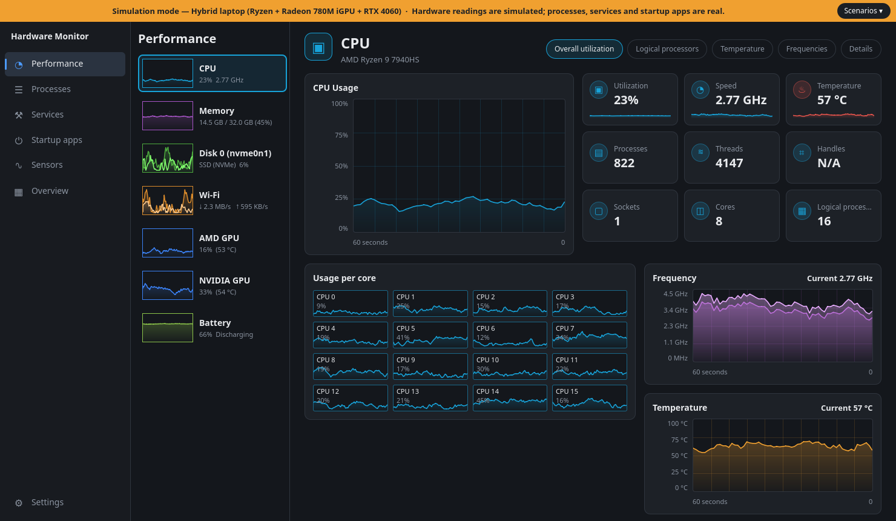
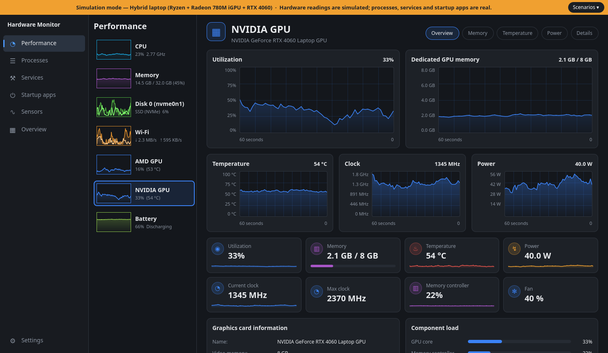
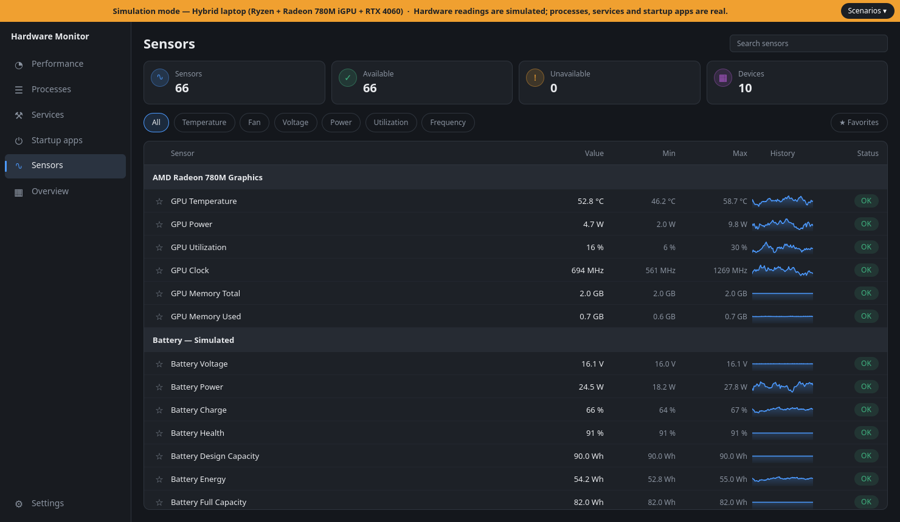
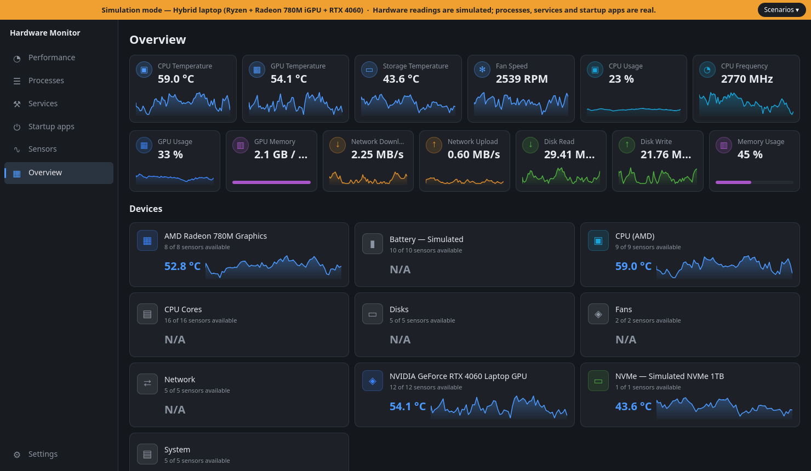

# Linux Hardware Monitor

A native Qt 6 / QML system monitor for Linux that combines a hardware sensor viewer with a Task Manager–style
interface. No Electron, no web view, no root: everything comes from `/sys`, `/proc`, D-Bus and (optionally) NVIDIA NVML.



<details>
<summary>More screenshots</summary>





</details>

The screenshots use the simulation mode (`mocks/hybrid-amd-nvidia-laptop.json`), so every number in them is made up
and the orange bar says so. To make your own: `LinuxHardwareMonitor --mock mocks/<profile>.json --page 0
--size 1480 860 --screenshot-delay 65000 --screenshot out.png` (offscreen: prefix `QT_QPA_PLATFORM=offscreen`).

## Features

- **Performance** – CPU (overall and per-core load, frequency, temperature, caches, topology), memory
  (composition, swap, slab), every disk (activity, throughput, usage, serial/firmware, since-boot totals, and a Health tab with the drive's own SMART data: wear, spare capacity, media errors, data written, power-on time - read through udisks2, no root needed),
  every network adapter (throughput, totals, packets, driver, IP addresses; Wi-Fi SSID/channel/security through
  NetworkManager), GPUs of any mix of vendors - NVIDIA (load, VRAM, clocks, power, encoder/decoder, driver/CUDA/PCI IDs), AMD (load, VRAM, temperature, fan, power, clocks) and Intel (clocks, power) and the laptop battery
  (charge, health, power, time remaining).
- **Processes** – applications grouped by name with expandable children, heat-map columns (CPU, memory, disk),
  sorting, search, End task / Force kill, Suspend / Resume, process priority (nice), processor affinity, Properties dialog.
- **Services** – systemd services over D-Bus: filter, search, start / stop / restart (asks for your password through polkit).
- **Startup apps** – XDG autostart entries with enable/disable (system entries are overridden in your own
  `~/.config/autostart`, never edited in `/etc`).
- **Sensors / Overview** – every hwmon sensor with min/max and history (search by name, filter by type, star your favourites; click a column header to sort inside each device group; click a sensor for a large chart with min/max/average and a per-sensor CSV export), plus a summary dashboard.
- **System tray** – optional icon with the program's logo (or, as a setting, the CPU temperature on a blue / amber / red tile) and a load/RAM tooltip; closing the window can keep the app running there (needs a desktop with tray support, e.g. the AppIndicator extension on GNOME).
- **History across restarts** – the last ~15 minutes of every sensor are saved on exit (and every 5 minutes) to `~/.local/share/LinuxHardwareMonitor/history.bin`; live charts start fresh after a restart, while the sensor detail window (click a sensor on the Sensors page) shows the restored history with the downtime as a gap. Not used in simulation or fixture mode.
- **Overheat notifications** – optional desktop notification (freedesktop `Notify` over D-Bus) when a temperature sensor reaches a threshold you choose, when the processor reports thermal throttling (Intel `thermal_throttle` counter), when an NVIDIA card reports a thermal slowdown, or when a fan that was spinning reads 0 RPM while the CPU/GPU is hot; off by default, one message per event. A temperature sensor can have a threshold of its own (in its detail window), which replaces the global one for that sensor.
- **Keyboard** – `Ctrl+1`…`Ctrl+7` switch pages, `Ctrl+F` focuses the search field of the Processes, Services and Sensors pages.
- **CPU temperature source** – Intel and AMD report several readings: one for the whole package (the hottest spot,
  what throttling reacts to) and one per core, and tools disagree on which is "the" CPU temperature (a package reading
  is typically 5-10 °C above the cores' average). Settings > Appearance lets you pick the package sensor (default),
  the hottest core or the average of the cores; the tiles say which one they show and the tray follows the choice.
- **Theme** – follows the desktop's dark/light preference (Settings > Appearance), or stays dark or light; the choice of earlier versions is kept.
- **Temperature unit** – Celsius or Fahrenheit (Settings); only what is shown changes, thresholds and data stay in Celsius.
- **System information** – Settings > About copies a short description of the hardware, versions and renderer for a bug report. It never contains serial numbers, MAC/IP addresses or Wi-Fi names.
- **Settings** – update interval, history length, dark/light theme, language, start with the system, CSV export of the history.
- **Languages** – English, Русский, Українська, Deutsch, Español (switchable at runtime, follows the system by default).

Anything that cannot be read without privileges (DIMM details, SMART data, RAPL energy counters) is shown as
"N/A" or left out; the app never invents values.

## Dependencies (Ubuntu / Debian)

```
sudo apt install build-essential cmake ninja-build python3 \
    qt6-base-dev qt6-declarative-dev \
    qml6-module-qtquick qml6-module-qtquick-controls qml6-module-qtquick-layouts \
    qml6-module-qtquick-window qml6-module-qtquick-templates
```

Optional at runtime: the proprietary NVIDIA driver (`libnvidia-ml.so.1`) for GPU metrics, NetworkManager for Wi-Fi
details, systemd for the Services page. Without them the corresponding parts are simply empty.

## Build, test, run

```
cmake -S . -B build -G Ninja
cmake --build build
ctest --test-dir build --output-on-failure
./build/LinuxHardwareMonitor
```

`LinuxHardwareMonitor --help` lists every option. Useful flags for screenshots and smoke tests: `--page <n>`, `--resource <n>`, `--size <w> <h>`,
`--screenshot <file.png>` (e.g. `QT_QPA_PLATFORM=offscreen ./build/LinuxHardwareMonitor --page 0 --screenshot out.png`).

## Resource usage

Pages are created only while they are visible, nothing is prepared for the interface (and no processes are scanned) while the window is hidden to the tray or minimized, static CPU facts are read once, and Qt Quick uses the software
renderer by default (about 150-190 MB RSS and 2-5 % of one core on a 32-thread machine, versus ~330 MB with OpenGL).
Set `QT_QUICK_BACKEND=rhi` (or `QSG_RHI_BACKEND=opengl`) to use the GPU renderer instead.

## Sensor dump for scripts

`LinuxHardwareMonitor --dump-json` prints every sensor once as JSON and exits. It needs no window or display, so it
also works over SSH. Unavailable sensors have `"value": null` (never 0). Rates such as CPU load and network speed
need two samples, so the sensors are read twice (`--dump-delay <ms>`, default 500) and the second round is printed;
`--compact` gives one line. It also works with `--mock` and the test-tree flags.

```
LinuxHardwareMonitor --dump-json --compact | jq '.sensors[] | select(.type=="temperature") | {device, name, value}'
```

The sensor ids and device names identify the hardware (for example the NVIDIA GPU's UUID); look at the output
before pasting it into a public bug report.

## Simulation and test data

Try other hardware without owning it: `./build/LinuxHardwareMonitor --mock mocks/amd-desktop.json` shows a simulated
Ryzen + Radeon system (profiles for AMD, Intel, NVIDIA, a minimal box and a stress test with overheating, GPU loss,
sensor dropout and fan changes). `--hwmon-root <dir>` runs the real hwmon parser on prepared files
(`tests/fixtures/`). Real hardware is always the default; simulation is opt-in and always announced by a bar at the top
of the window. Details and the profile format: `mocks/README.md`.

## Install

Download the package for your system from the [Releases](https://github.com/Zbara/LinuxHardwareMonitor/releases)
page: `ubuntu26.04` (Ubuntu 26.04) or `debian13` (Debian 13). A package depends on the Qt version of its
distribution, so the one for another release will not install.

```
sha256sum -c SHA256SUMS --ignore-missing
sudo apt install ./linux-hardware-monitor_0.1.0-1_ubuntu26.04_amd64.deb
```

If `apt` prints a notice about the `_apt` user, copy the file out of your home directory first (e.g. to `/tmp`).
Releases are signed: `SHA256SUMS.asc` is a detached signature of `SHA256SUMS`.

```
gpg --import signing-key.asc            # in the release, or docs/signing-key.asc in this repository
gpg --fingerprint 455F2B9C5659DD1BECB73300F2AAEDFB7B8CB932
gpg --verify SHA256SUMS.asc SHA256SUMS
sha256sum -c SHA256SUMS --ignore-missing
```

Signing key: **Zbara (Linux Hardware Monitor releases) <zbara.dev@gmail.com>**, ed25519, valid until 2029-10-24,
fingerprint

```
455F 2B9C 5659 DD1B ECB7  3300 F2AA EDFB 7B8C B932
```

`gpg --verify` says "unknown" for the trust of a key you have just imported; what matters is that the fingerprint it
prints is this one. Maintainers: see `RELEASING.md`.

## Build a package yourself

```
cmake -S . -B build -G Ninja -DHWMON_DISTRO_TAG=ubuntu26.04
cmake --build build
cd build && cpack -G DEB          # linux-hardware-monitor_0.1.0-1_ubuntu26.04_amd64.deb
cmake --install build --prefix /usr/local      # or install without a package
```

The default build type is `Release`. `packaging/` holds the desktop entry (localized), the icon, the manual page,
the AppStream file, the Debian changelog and copyright. The package is checked with `lintian` (clean at warning
level) and `appstreamcli` in CI.

## Project layout

| Path | Contents |
|------|----------|
| `src/core` | `SensorManager` (one polling thread, history, min/max), process scanner/monitor/control, systemd and NetworkManager clients, hardware facts, localization |
| `src/providers` | `ISensorProvider` implementations: hwmon, NVIDIA NVML, system (CPU/RAM), I/O (network, disks), battery |
| `src/models` | Qt list/proxy models for sensors, processes, services, startup entries |
| `src/ui` | `AppController` – the single object exposed to QML |
| `qml` | Pages, reusable components (charts, tiles, cards) and the theme |
| `translations` | One JSON file per language (source-text keyed) |
| `tests` | Qt Test suites; hardware access is injectable, so they run against fake `/sys` and `/proc` trees |
| `tools` | Translation table and checker (`tools/translations_table.py`, `tools/check_translations.py`) |

## Adding or changing UI text

Wrap the string in `qsTr()` (QML) or `tr()` (C++), add a row with all languages to `tools/translations_table.py`, then run
`python3 tools/translations_table.py`. The `translations_complete` test fails when a string is missing, stale or has
mismatching `%1` placeholders.
